# Звіт до проєктної роботи: пошук широких подвійних зірок у Gaia DR3

Репозиторій з кодом, доказами й скриншотами: https://github.com/Alhaff/big_data_gaia_wide_stars_search

## 1. Яку задачу було поставлено

Широкі подвійні зірки - гравітаційно пов'язані пари з відстанню між компонентами від сотень до десятків тисяч астрономічних одиниць (а.о.).
Їх можна знайти за трьома ознаками:
- зірки близькі на небі;
- мають однаковий паралакс, тобто стоять на однаковій відстані від нас;
- мають однаковий власний рух, тобто разом рухаються по небу.

Будемо шукати скільки широких подвійних зірок у цій ділянці неба, як вони розподілені за відстанню між компонентами, а також перевіримо до якої відстані знайденим парам можна довіряти, тобто де випадкові збіги починають переважати.

Одним проходом задачу не розв'язати, бо:
1. Кожну зірку треба порівняти з сусідами. Порівняння всіх пар має складність O(N²): для 1,78 млн зірок це 1,6·10¹² пар. Тож зірки спершу групуються за комірками неба (shuffle за коміркою), і пари шукаються лише всередині комірки та з сусідніми.
2. Знайдені пари треба порахувати для кожної зірки, щоб відкинути скупчення. Це агрегат за `source_id` над результатом етапу 2, тож на сирих записах цей етап неможливий.
3. Пари зі спільними зірками треба об'єднати в системи (трійки й більші). Це ітеративний пошук зв'язних компонент.
4. Частку випадкових збігів оцінюємо, повторюючи пошук на каталозі, зсунутому на 0,5°. Отримані пари не можуть бути справжніми, тож їхня кількість показує, скільки випадкових збігів серед знайдених.
5. Результат перевіряємо за каталогом El-Badry et al. (2021).

## 2. Обраний датасет

Gaia - космічна обсерваторія ESA, яка вимірювала положення, відстані й рухи зірок нашої Галактики.
Таблиця `gaia_source` релізу DR3 - основний каталог: 1 811 709 771 запис, 152 колонки, 3 386 файлів `.csv.gz` (формат ECSV).
Посилання: https://cdn.gea.esac.esa.int/Gaia/gdr3/gaia_source/

### Як вибрано ділянку

Назва файлу `GaiaSource_AAAAAA-BBBBBB.csv.gz` - це діапазон пікселів HEALPix рівня 8 (рівень визначає рівень деталізації сітки, на яку розбивається небесна сфера), тож місце кожного файлу на небі відоме без його відкриття.
Для вибірки з повного датасету було обрано небо за зеніту над Києвом опівночі 31.01.2026. Відповідно отримали: Dec, рівний широті Києва (+50,45°), і RA, рівний місцевому зоряному часу (8,71 год = 130,67°).
Скрипт `scripts/download_gaia.py` сортує файли за медіанною кутовою відстанню їхніх пікселів від зеніту і бере найближчі, поки оцінка кількості записів не досягне 12 млн. Вийшов круг радіусом ≈24°.

| | Оцінка до завантаження | Факт |
|---|---:|---:|
| Файлів | 22 | 22 |
| Розмір `.csv.gz` | 5,16 ГБ | 5,16 ГБ |
| Записів | ≈12,4 млн | 11 682 760 |
| Розмір без стиснення | ≈15,7 ГБ | 14,88 ГБ |

Список файлів, MD5 і точні розміри є в `dataset/`.

### Схема (12 колонок зі 152)

| Колонка | Тип, одиниці | Зміст |
|---|---|---|
| `source_id` | int64 | ідентифікатор; старші біти - номер пікселя HEALPix |
| `ra`, `dec` | float64, градуси | координати |
| `parallax`, `parallax_error` | float64, мас | паралакс і похибка; відстань у пк = 1000 / ϖ |
| `pmra`, `pmra_error`, `pmdec`, `pmdec_error` | float64, мас/рік | власний рух і похибки |
| `phot_g_mean_mag` | float64, зор. вел. | яскравість |
| `bp_rp` | float64, зор. вел. | колір |
| `ruwe` | float64 | якість астрометрії |

## 3. Чому Spark

**Що дав Spark у цьому запуску.**

| Етап | Час етапу | Сумарний час задач | Прискорення |
|---|---:|---:|---:|
| 1. Читання й фільтр | 123 с | 864 с | 7,0× |
| 2. Пошук пар | 189 с | 1 347 с | 7,1× |
| 5. Випадкові збіги | 253 с | 1 872 с | 7,4× |
| Увесь конвеєр | ≈10 хв | ≈69 хв | ≈7× |

Сумарний час задач - це приблизно час, який зайняв би той самий код в одному потоці. На 8 потоках Spark дав ≈7×, тобто майже лінійне прискорення.

**Переваги Spark для даної задачі:**
- **Читання 14,9 ГБ CSV.** 22 файли `.csv.gz` Spark читає паралельно, по одній задачі на файл, і одразу пише Parquet лише з 12 потрібних колонок. Далі всі етапи читають 0,1-0,2 ГБ Parquet замість 15 ГБ CSV.
- **Пошук пар - це природний MapReduce.** Map: кожна зірка йде у свою комірку неба і копіями в сусідні. Shuffle за номером комірки. Reduce: пошук пар у комірці векторизованим numpy (`applyInPandas`). Це знижує кількість порівнянь з 1,6·10¹² до 4,05·10⁸, тобто в ≈4 000 разів.
- **Масштабування.** Той самий код без змін працює на всьому Gaia DR3 (у 155 разів більше записів). Ключ - комірка HEALPix, їх на всьому небі 786 432, тож задачі розподіляються між вузлами кластера.
- **Оптимізатор і AQE** самі зробили кілька речей, які вручну довелося б писати окремо:
  - замінили join з маленькою таблицею на broadcast (етапи 3, 4, 5);
  - злили 200 розділів shuffle у 15 задач по ≈64 МБ (етап 2);
  - на вибірці прибрали anti join з порожньою таблицею.
- **Вимірюваність.** History Server і журнал подій показують план кожного запиту, розмір кожного shuffle і час кожної задачі. На цих даних побудовано карту фаз, аналіз перекосу й експеримент.
- **Особисті вподобання.** Spark краще відклався в голові, ніж Hive, і для мене має переваги над чистим MapReduce: він сам розділяє задачі на job-и і вимагає меншого синтаксису для реалізації запитів.

**Де Spark зайвий, якщо чесно.** Після етапу 1 лишається 1,78 млн зірок, і їх вистачило б пам'яті одного процесу. Можливо, датасет і задача були обрані не найкращим чином, бо перевага Spark у цій задачі - етап 1 (15 ГБ сирих даних) і масштабованість на все небо.
Крім того, експеримент з розділу 8 показав, що ≈50% часу задач етапу 2 - накладні витрати на кожну групу `applyInPandas` (передача комірки в Python через Arrow, створення DataFrame), а не сама арифметика.

**Чому `applyInPandas`, а не self-join за коміркою.** Self-join дав би рядок на кожну пару-кандидата, тобто 4·10⁸ рядків у наступному shuffle замість 8,9 млн. `applyInPandas` порівнює зірки комірки всередині однієї задачі, і в shuffle йдуть лише самі зірки.

## 4. Алгоритм

### Схема етапів

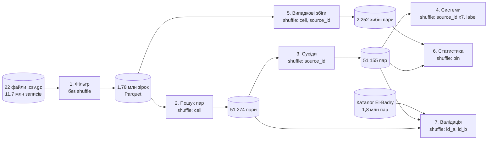

### Етапи, ключі й combiner

| Етап | Що робить | Ключ shuffle | Чому такий ключ | Combiner |
|---|---|---|---|---|
| 1. Фільтр | читає CSV, відкидає брудні записи, лишає 12 колонок, додає `cell = source_id >> 43` | немає | вузькі перетворення | не потрібен |
| 2. Пошук пар | копіює зірки в сусідні комірки з меншим номером, групує за коміркою, шукає пари за 3 критеріями | `cell` (комірка HEALPix рівня 8, 0,23°) | пара може бути лише в сусідніх комірках: комірка 824″ більша за максимальну відстань пари 500″ | неможливий: функції пошуку потрібна вся комірка |
| 3. Сусіди | рахує, у скільки пар входить кожна зірка, і відкидає пари, де зірка має понад 3 супутники | `source_id` | кількість потрібна для кожної зірки окремо | так: `HashAggregate` partial перед shuffle |
| 4. Системи | поширює найменшу мітку по ребрах графа пар, доки мітки не перестануть змінюватися | `source_id`, потім `label` | мітка - властивість вершини; розмір системи - кількість вершин з однаковою міткою | так: часткові `min` і `count` |
| 5. Випадкові збіги | етапи 2-3 на «оригінал + копія зі зсувом 0,5° за dec», лишає лише пари «оригінал - копія» | `cell`, `source_id` | як на етапах 2-3 | як на етапах 2-3 |
| 6. Статистика | рахує справжні й випадкові пари в бінах `floor(log10(s) · 2)` | `bin` | ≈7 ключів, результат - маленька таблиця | так: часткові `count` |
| 7. Валідація | join наших пар з каталогом El-Badry | `(id_a, id_b)` | пара однозначно задається двома `source_id` | не потрібен |

Обов'язкові shuffle курсу: на етапі 2 (`groupBy(cell)`) і на етапі 3 (`groupBy(source_id)`). Обидва є у фактичному плані й не замінені на broadcast. Етап 3 споживає агрегат етапу 2 (пари), а на сирих записах його виконати не можна.

**Три критерії пари** (для точності порівняння були взяті критерії як у El-Badry et al. 2021, ϖ1 - паралакс яскравішої зірки):
1. θ < 50 000 а.о. · ϖ1 / 1000, тобто проєкційна відстань s < 50 000 а.о.;
2. |ϖ1 − ϖ2| < b·√(σ1² + σ2²), де b = 3, а для θ < 4″ b = 6;
3. Δμ ≤ 0,44428 · ϖ1^1,5 · θ^−0,5 + 2σ_Δμ, тобто різниця власних рухів не більша за орбітальну швидкість пари з масою 5 мас Сонця плюс похибка.

**Чому копії лише в комірки з меншим номером.** Тоді пара із зірок у комірках c_a < c_b знаходиться лише в комірці c_a: зірка b туди скопіювалась, а зірка a в c_b - ні. Кожна пара знаходиться рівно один раз без `dropDuplicates`. У середньому менший номер мають 4 сусіди з 8, тож у shuffle 5N рядків замість 9N. Що це дає, перевірено в експерименті (розділ 8).

### Оцінка проти факту

Вихідні числа оцінки: N ≈ 1,75 млн зірок після фільтра (15,0% з вибірки по 20 000 рядків з кожного файлу), C ≈ 37 600 комірок, P ≈ 5·10⁴ пар.

| Етап | Вхід (ключ, значення) | Вихід (ключ, значення) | Що йде в shuffle | Оцінка записів і байтів | Факт | Stage / job |
|---|---|---|---|---|---|---|
| 1. Читання й фільтр | (-, рядок CSV) | (-, 12 колонок + cell + origin) | нічого | вхід 11,68 млн / 5,16 ГБ стиснено; вихід ≈1,75 млн × 108 Б ≈ 190 МБ, Parquet ≈0,1-0,2 ГБ; 22 задачі | вихід 1 782 969 (+1,9%); 22 задачі; вхід 5 159 МБ, **прочитано двічі** | job 1 / stage 1 (підрахунок брудних), job 3 / stage 4 (запис) |
| 2. Пошук пар | (cell, зірка + is_home) | (-, пара: id₁, id₂, θ, s, Δμ) | зірки й копії в сусідні комірки | 5N ≈ 8,7 млн рядків × 128 Б ≈ 1,1 ГБ; ключів ≈37 600; порівнянь ≈3,7·10⁸; вихід P ≈ 5·10⁴ пар | 8 939 358 рядків (5,01 на зірку), **888,8 МБ**; ключів 37 878; порівнянь 4,05·10⁸; 51 274 пари | job 8 / stage 10 (shuffle write), job 9 / stage 12 (`applyInPandas`) |
| 3. Сусіди | (source_id, 1) | (source_id, n) | часткові count | ≤ 2P ≈ 10⁵ рядків × 24 Б ≈ 2,4 МБ; ключів ≤ 2P | 101 280 рядків після часткової агрегації (зі 102 548), 1,3 МБ; 100 533 ключі; 51 155 пар | job 24 / stage 36, job 25 / stage 38 |
| 4. Системи | (source_id, label) | (source_id, label), потім (label, розмір) | мітки на кожній ітерації | ≈ 4P ≈ 2·10⁵ рядків за ітерацію, ≈5 МБ; 2-3 ітерації | ≈202 000 рядків, 3,1 МБ за ітерацію; **7 ітерацій** | jobs 36-90 (ітерація 1: stages 63, 67), jobs 92-93 (розміри) |
| 5. Випадкові збіги | (cell, зірка оригіналу або копії) | (-, хибна пара) | 2N зірок і їхні копії | 10N ≈ 17,5 млн рядків ≈ 2,2 ГБ; порівнянь ≈1,5·10⁹ | 17 881 438 рядків, 1 779,2 МБ; 2 252 пари | job 97 / stage 156 (shuffle write), job 98 / stage 158 (пошук) |
| 6. Статистика | (bin, 1) | (bin, кількість) | часткові count | ≈7 ключів × кількість задач, кілобайти | 56 рядків (7 бінів × 8 задач), < 0,1 МБ | job 109 / stage 172 |
| 7. Валідація (додано після коміту оцінок) | (id_a, id_b) | повнота, чистота | очікував broadcast | обидві сторони ≈5·10⁴ рядків, ≈2 МБ | **2 shuffle**: 51 274 + 46 959 рядків, 2,2 МБ | jobs 116-119 / stages 186, 188, 191 |

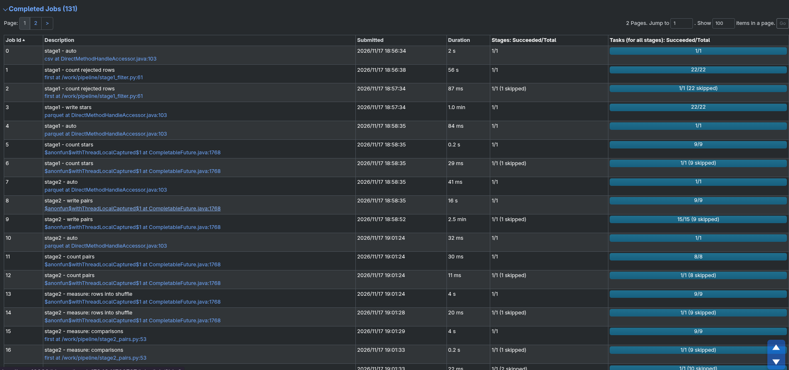

*Рисунок 1 - job-и 0-16 повного запуску з підписами етапів (усього 131)*

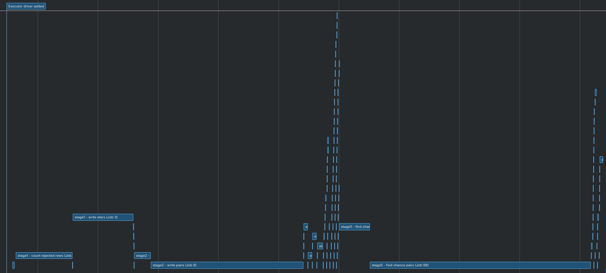

*Рисунок 2 - Event Timeline повного запуску: читання CSV (job-и 1 і 3), пошук пар (job 9) і випадкові збіги (job 98) займають майже весь час, решта job-ів - короткі вертикальні риски між ними*

Кожен job підписаний як `<етап> - <дія>`, наприклад `stage2 - write pairs`. Job-и, які Spark запускає сам (читання схеми Parquet), підписані `<етап> - auto`.
Усього в запуску 131 job (0-130) (не очікував, що вийде настільки багато). Кожна дія (`write`, `count`, `collect`) - окремий job, а AQE запускає ще по job-у на кожен shuffle і broadcast, які треба виконати перед нею. Найбільше job-ів дає етап 4: 7 ітерацій, у кожній дві дії (`localCheckpoint` і підрахунок змінених міток) і по кілька job-ів AQE, разом job-и 36-90.

### Великі розбіжності між оцінкою і фактом

- **Етап 1 читає CSV двічі.** Підрахунок брудних записів (`count rejected rows`) - окремий job з повним читанням 5,16 ГБ: 415 с часу задач з 864, тобто майже половина етапу. Рахувати відкинуті рядки разом із записом дешевше. Я лишив окремий job, бо для звіту потрібна кількість для кожного правила окремо.
- **Shuffle етапу 2 на 20% менший** (888,8 МБ проти 1,1 ГБ). Рахували рядок як UnsafeRow без стиснення (128 Б), а Spark стискає shuffle через lz4: 888,8 МБ / 8 939 358 ≈ 99 Б на рядок.
- **Порівнянь на 9% більше за рівномірну модель.** З фактичним N модель дає 4,5 × (1,783·10⁶)² / 37 600 ≈ 3,80·10⁸, а факт 4,05·10⁸. Густина зірок не зовсім рівномірна, а вартість комірки росте як квадрат кількості зірок у ній.
- **Етап 4: 7 ітерацій замість 2-3.** Є дві системи з 9 зірок і дві з 5. Це ланцюжки, у яких мітка проходить одне ребро за ітерацію. Вони пройшли фільтр «не більше 3 супутників», бо в ланцюжку кожна зірка має мало сусідів. Найімовірніше, це залишки рухомих груп.
- **Combiner етапу 3 майже нічого не дає.** Часткова агрегація зменшила 102 548 рядків лише до 101 280 (−1,2%, Рисунок 4): одна зірка рідко трапляється двічі в межах однієї задачі, бо майже кожна зірка має лише одну пару. На таких даних combiner коштує більше, ніж заощаджує, але shuffle там і так 1,3 МБ.
- **Етап 5 у 1,4 раза довший за етап 2 за часом задач** (1 872 проти 1 347 с), хоча порівнянь у ≈4 рази більше. Час визначають накладні витрати на групу, а не порівняння (розділ 8).
- **Етап 7: shuffle замість broadcast.** Я забув, що full outer join Spark не вміє робити через broadcast: broadcast-сторона мала б віддати й рядки без пари, а кожна задача бачить лише свою частину іншої сторони. Тому join з каталогом - SortMergeJoin з двома shuffle за `(id_a, id_b)`. Другий join (left outer з парами етапу 3) став broadcast.

## 5. Карта фаз

Плани до запуску (`explain("formatted")`) збережено в `evidence/plans/`, фінальні плани після AQE видно на вкладці SQL у History Server.

| Етап | Рядок коду | Що в плані | Що зробив AQE |
|---|---|---|---|
| 1 | `spark.read.csv(...)`, `filter`, `withColumn` (`stage1_filter.py`) | `Scan csv` - `Filter` - `Project`, без Exchange | нічого |
| 2 | `copies.groupBy("cell").applyInPandas(...)` (`stage2_pairs.py`) | `MapInPandas` - **`Exchange hashpartitioning(cell, 200)`** - `Sort` - `FlatMapGroupsInPandas` | злив 200 розділів у 15 задач по ≈64 МБ |
| 3 | `ends.groupBy("source_id").count()` (`companions`) | `HashAggregate` (partial) - **`Exchange hashpartitioning(source_id)`** - `HashAggregate` (final) | - |
| 3 | `pairs.join(crowded, ..., "left_anti")` × 2 (`drop_crowded`) | `BroadcastExchange` - `BroadcastHashJoin LeftAnti` | broadcast уже в статичному плані, бо розмір Parquet відомий; на вибірці `crowded` порожня, і AQE прибрав обидва join |
| 4 | `labels.union(from_neighbours).groupBy("source_id").agg(min)` | **`Exchange hashpartitioning(source_id)`** на кожній ітерації | join `edges` з `labels` - `BroadcastHashJoin` |
| 5 | `find_pairs(both, ...)` (`stage5_chance.py`) | `Union` - `MapInPandas` - **`Exchange hashpartitioning(cell)`** - `FlatMapGroupsInPandas` | - |
| 5 | `drop_crowded(pairs, companions(pairs))` | після `localCheckpoint` статичний план має 4 Exchange і `SortMergeJoin LeftAnti`: Spark не знає розміру даних | побачив, що `crowded` має 15 рядків, і замінив обидва SortMergeJoin на `BroadcastHashJoin`; ліва сторона читається як `AQEShuffleRead local` |
| 6 | `groupBy("bin").count()` і `join(..., "full_outer")` | `HashAggregate` - **`Exchange hashpartitioning(bin)`** ×2 - `SortMergeJoin FullOuter` | злив усе в одну задачу |
| 7 | `theirs.join(ours2, ..., "full_outer")` (`stage7_validate.py`) | **`Exchange hashpartitioning(id_a, id_b)`** ×2 - `SortMergeJoin FullOuter`, потім `BroadcastHashJoin LeftOuter` з етапом 3 | - |

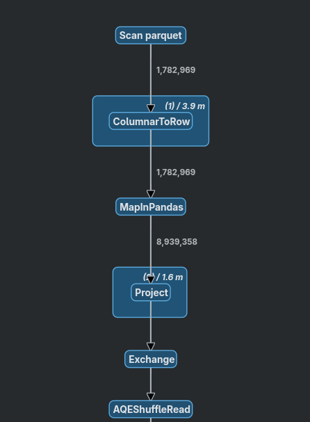 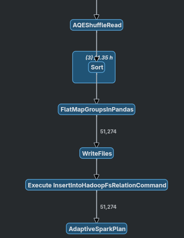

*Рисунок 3 - фінальний план етапу 2 (`stage2 - write pairs`): `MapInPandas` перетворює 1 782 969 зірок на 8 939 358 рядків, далі `Exchange` за коміркою, `AQEShuffleRead` і `FlatMapGroupsInPandas`, на виході 51 274 пари*

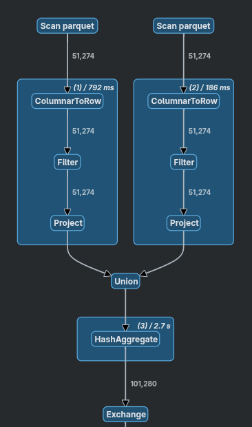 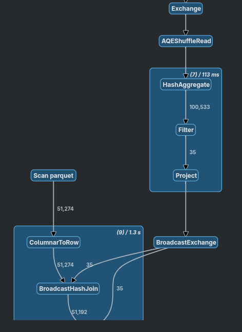 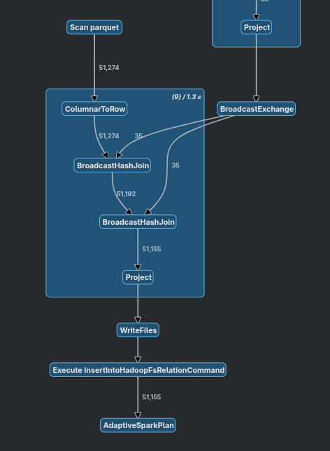

*Рисунок 4 - план етапу 3: дві гілки по 51 274 рядки, `HashAggregate` (partial) до `Exchange` і `HashAggregate` (final) після нього; 35 зірок зі скупчень ідуть у `BroadcastExchange`, два `BroadcastHashJoin` (LeftAnti) лишають 51 192, потім 51 155 пар*

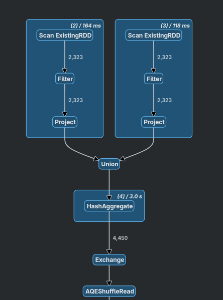 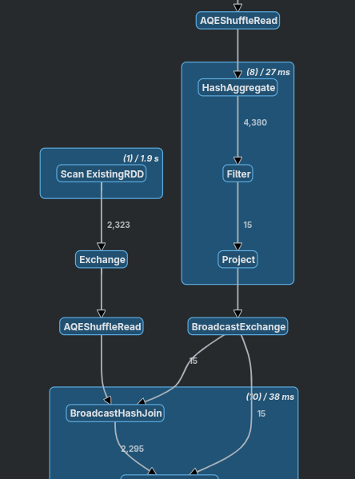 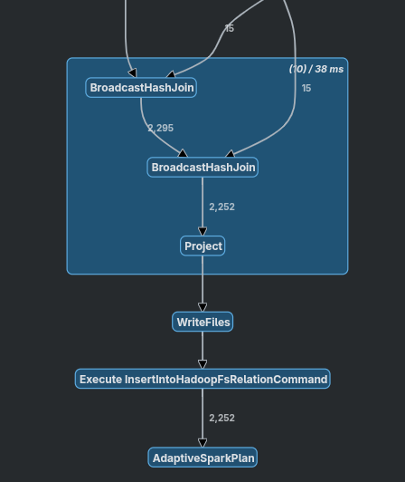

*Рисунок 5 - фінальний план етапу 5 після AQE: у статичному плані тут були `SortMergeJoin`, а AQE побачив, що зірок зі скупчень лише 15, і замінив обидва join на `BroadcastHashJoin`*

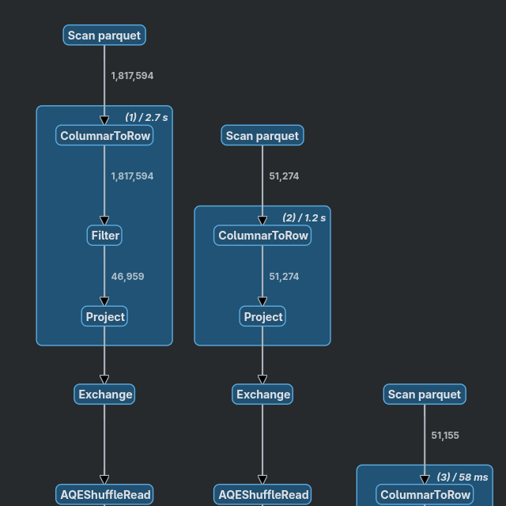 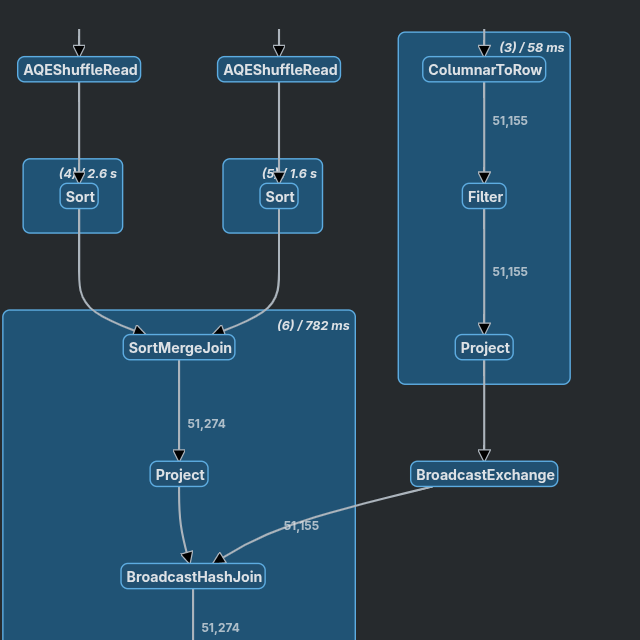 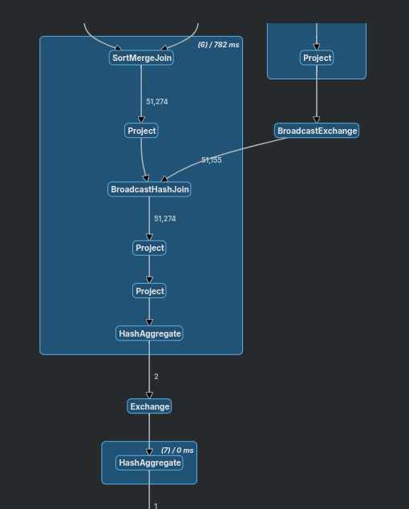 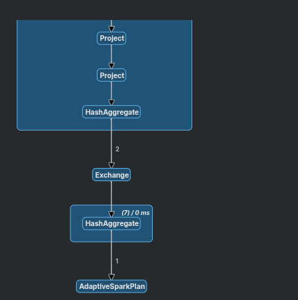

*Рисунок 6 - план етапу 7 (`stage7 - validation totals`): з 1 817 594 пар каталогу фільтр лишає 46 959, обидві сторони йдуть через `Exchange` у `SortMergeJoin` (full outer), а пари етапу 3 (51 155) приєднуються через `BroadcastHashJoin`*

**Що оптимізатор зробив не так, як я планував.** На практиці з'ясувалося, що перша версія етапу 5 рахувала пари тричі.
Результат пошуку пар (`pairs`) використовується тричі: дві гілки `union` у `companions` і основа `drop_crowded`.
AQE перевикористав сам shuffle копій (записаний один раз), але `FlatMapGroupsInPandas` після shuffle не перевикористовувався, тож пошук пар виконувався в трьох місцях:

| Запуск на вибірці | До | Після |
|---|---|---|
| Stage-і, що читають shuffle з копіями (10,1 МБ) | 2: 20,2 МБ і 10,1 МБ | 1: 10,1 МБ |
| Час задач пошуку пар | 35,6 + 13,0 ≈ 49 с | 25,0 с |
| Етап 5 загалом | 9,6 с | 6,6 с |
| Випадкових пар | 10 | 10 |

Виправлення: `pairs.localCheckpoint()` одразу після пошуку пар. Пари рахуються один раз і зберігаються на виконавцях, а lineage обрізається.
Той самий прийом використано на кожній ітерації етапу 4, інакше план ітерації k містив би всі k − 1 попередніх.

## 6. Брудні дані

Обробка брудних записів - окремий крок етапу 1 (`stage1_filter.rules()`). Кожне правило рахується окремо однією агрегацією, тож один рядок може не пройти кілька правил.

| Правило | Чому відкидаємо | Не пройшли | Частка |
|---|---|---:|---:|
| `has_parallax` | немає паралаксу: розв'язок лише з положенням (`astrometric_params_solved = 3`), відстань невідома | 1 662 113 | 14,2% |
| `has_proper_motion` | немає власного руху; це ті самі рядки, що й без паралаксу | 1 662 113 | 14,2% |
| `has_g_mag` | немає зоряної величини G, не визначити яскравішу зірку пари | 11 008 | 0,09% |
| `parallax_over_error` | ϖ/σ ≤ 5: похибка відстані понад 20% або від'ємний паралакс | 6 626 729 | 56,7% |
| `distance_100_1000pc` | паралакс поза 1-10 мас, тобто зірка ближче 100 пк або далі 1 000 пк | 6 900 374 | 59,1% |
| **Пройшли всі правила** | | **1 782 969** | **15,3%** |

Значення `null` у CSV Gaia записане текстом `"null"`, тож читаю з `nullValue="null"`. Типи колонок задаю явно, бо `inferSchema` - це ще один повний прохід по 15 ГБ.
Найбільше відсіює відстань: більшість зірок Gaia в цьому напрямку далі за 1 кпк, і їхній паралакс менший за 1 мас або неточний.

Приклади відкинутих рядків з вибірки (`make dirty`, повний вивід у `docs/dirty_examples.md`; значення округлено):

| `source_id` | ϖ, мас | σ_ϖ, мас | `pmra`, `pmdec` | G | `astrometric_params_solved` | Яке правило не пройшов |
|---|---:|---:|---|---:|---:|---|
| 1014294975498242688 | null | null | null, null | 20,76 | 3 | `has_parallax`, `has_proper_motion`: розв'язок лише з положенням, бо зірка слабка |
| 1014983166697564672 | −0,39 | 2,09 | −3,28, −0,74 | null | 95 | `has_g_mag`, а також обидва правила паралаксу |
| 1014294361319058816 | 1,94 | 1,00 | 1,59, 0,69 | 20,09 | 95 | `parallax_over_error`: відстань у межах, але ϖ/σ = 1,9, тобто похибка ≈50% |
| 1014292845194731392 | 0,53 | 0,17 | 2,40, −8,72 | 18,38 | 31 | `distance_100_1000pc`: ϖ < 1 мас, зірка далі 1 кпк (і ϖ/σ = 3,1) |
| 1014294425743421312 | −0,15 | 0,23 | −0,36, −0,15 | 18,88 | 31 | обидва правила паралаксу: від'ємний паралакс, фізично неможливий, це шум вимірювання далекої зірки |

`astrometric_params_solved` пояснює, звідки порожні поля: 3 - Gaia визначила лише положення (2 параметри), 31 і 95 - повний розв'язок з паралаксом і власним рухом (5 або 6 параметрів).
Тому `has_parallax` і `has_proper_motion` відкидають рівно ті самі рядки.
На вибірці частки близькі до повного датасету: пройшло 18,7% (10 141 з 54 243) проти 15,3%.

## 7. Перекіс

Перекіс дивимося у двох місцях: розподіл записів по ключах і розподіл по задачах. Друге і є вартістю перекосу: stage закінчується, коли закінчиться найдовша задача.

**Розподіл по ключах:**

| Shuffle | Ключ | Різних ключів | Найчастіший ключ, записів | Медіана | Частка топ-10 |
|---|---|---:|---:|---:|---:|
| Етап 2: пошук пар | комірка | 37 878 | 652 | 224 | 0,06% |
| Етап 3: супутники | `source_id` | 100 533 | 8 | 1 | 0,06% |
| Етап 4: мітки | мітка системи | 49 807 | 9 | 2 | 0,05% |
| Етап 5: випадкові пари | комірка | ≈37 900 | ті самі комірки, що й на етапі 2 | | |
| Етап 7: join з каталогом | пара `(id_a, id_b)` | 51 274 | 1 | 1 | 0,02% |

**Розподіл по задачах** (`scripts/shuffle_skew.py`, з журналу подій; одна задача читає кілька розділів, які AQE злив до ≈64 МБ):

| Stage | Job | Задач | Записів на задачу: max / медіана | Байтів: max / медіана, МБ | Час задачі: max / медіана, с |
|---:|---|---:|---:|---:|---:|
| 12 | stage2 - write pairs | 15 | 643 018 / 622 914 | 63,9 / 61,9 | 88,7 / 80,0 |
| 158 | stage5 - find chance pairs | 30 | 640 400 / 622 122 | 63,7 / 61,9 | 65,4 / 59,4 |
| 63-137 | stage4 - iteration N | 2-3 | ≈72 600 / ≈65 000 | 1,1 / 1,0 | ≤ 0,5 |
| 191, 201 | stage7 - validation | 2-3 | 54 113 / 49 116 | 1,2 / 1,1 | ≤ 0,4 |

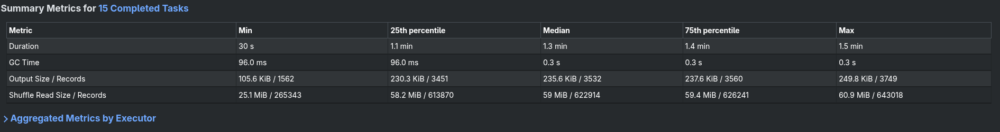

*Рисунок 7 - Summary Metrics stage 12 (пошук пар етапу 2): тривалість і shuffle read 15 задач*

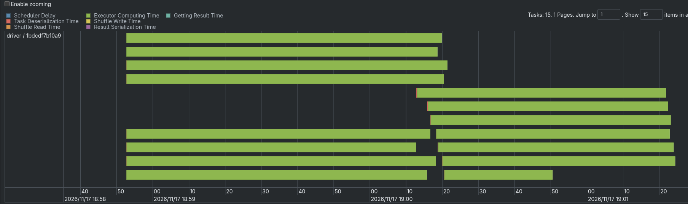

*Рисунок 8 - Event Timeline задач stage 12: 15 задач двома хвилями на 8 потоках, остання задача коротша, бо їй дістався залишок даних*

```
етап 2, записів:  643 018 / 622 914 = 1,03
етап 2, час:      88,7 / 80,0       = 1,11
етап 5, час:      65,4 / 59,4       = 1,10
```

На Рисунку 7 найкоротша задача (30 с, 265 343 записи) помітно менша за решту: AQE злив розділи в задачі по ≈64 МБ, і останній задачі дістався залишок. Перекосу це не означає, бо вона закінчується раніше за інші, а не пізніше.
Найдовша задача етапу 2 лише на 8,7 с довша за медіану. Отже, перекіс коштує ≈9 с на етапі 2 і ≈6 с на етапі 5, тобто ≈5% і ≈2% часу цих етапів.
Різниця в часі більша, ніж у записах (1,11 проти 1,03), бо час задачі залежить від кількості порівнянь, а вона росте як квадрат кількості зірок у комірці.

**Висновок: перекосу фактично немає, і так задумано вибором ключа.** Комірки HEALPix рівновеликі за площею, а ділянка далеко від площини Галактики, тож густина зірок майже рівномірна: найбільша комірка лише в 2,9 раза більша за медіану.
Окремо з перекосом нічого не робив. Якби ділянка перетинала площину Галактики чи скупчення, густина зростала б у десятки разів, а порівнянь у комірці - у сотні разів. Тоді варто було б брати дрібніші комірки в густих місцях (адаптивний рівень HEALPix). `spark.sql.adaptive.skewJoin` тут не допоміг би: він ділить лише join, а не групи `applyInPandas`.

## 8. Експеримент

### Що змінюю

На етапі 2 зірка копіюється лише в сусідні комірки з меншим номером (варіант A), і кожна пара знаходиться рівно один раз.
Очевидніший варіант B: копіювати зірку в усі 8 сусідніх комірок, а пари, знайдені двічі, прибирати через `dropDuplicates`.
Змінюю лише це (`--all-neighbours`), запускаю лише етап 2 на тому самому `stage1_stars.parquet`.

### Гіпотеза

```
рядків у shuffle:  A = 5N,  B = 9N            B / A = 1,8
порівнянь:         A = 4,5m², B = 8,5m²      B / A ≈ 1,9
```

Початкова гіпотеза: shuffle write у варіанті B в 1,8 раза більший, а час етапу в ≈1,8-1,9 раза більший.
Запуск на вибірці показав, що на кожну комірку йде ≈39 мс незалежно від кількості порівнянь (накладні витрати `applyInPandas`). Тож я уточнив: точно в прогноз потрапить лише shuffle, а час зросте від 1,0 до 1,8 раза.

### Умови

- i5-9300H (4 ядра, 8 потоків), 16 ГБ RAM, дані Gaia на HDD, тимчасові файли Spark на NVMe SSD;
- Spark 4.2.0, `local[*]`, `spark.driver.memory 6g`, контейнер Podman;
- вхід - Parquet етапу 1 (≈0,2 ГБ), після першого читання в page cache, тобто вимірювання «з теплим кешем» для обох варіантів;
- 8 запусків у порядку A, B, A, B, ..., перша пара - прогрів і не рахується;
- `--no-measure`: без додаткових job-ів вимірювання; під час замірів нічого іншого не запущено.

### Результати

| Запуск | Варіант | Етап 2, с | Shuffle write, МБ | Час задач, с |
|---|---|---:|---:|---:|
| `local-1794943165355` | A | 163,5 | 888,8 | 1 138,6 |
| `local-1794943340168` | B | 226,8 | 1 599,5 | 1 599,3 |
| `local-1794943578069` | A | 164,9 | 888,8 | 1 150,4 |
| `local-1794943754039` | B | 230,8 | 1 599,5 | 1 627,8 |
| `local-1794943996097` | A | 162,0 | 888,8 | 1 124,1 |
| `local-1794944169188` | B | 227,4 | 1 599,5 | 1 600,7 |
| **Медіана A** | | **163,5** | **888,8** | **1 138,6** |
| **Медіана B** | | **227,4** | **1 599,5** | **1 600,7** |

Прочитані дані однакові: 0,2 МБ Parquet в обох варіантах. В обох варіантах 51 274 пари.
Розкид усередині варіанту не перевищує 4 с (1,8%), різниця між варіантами 64 с.

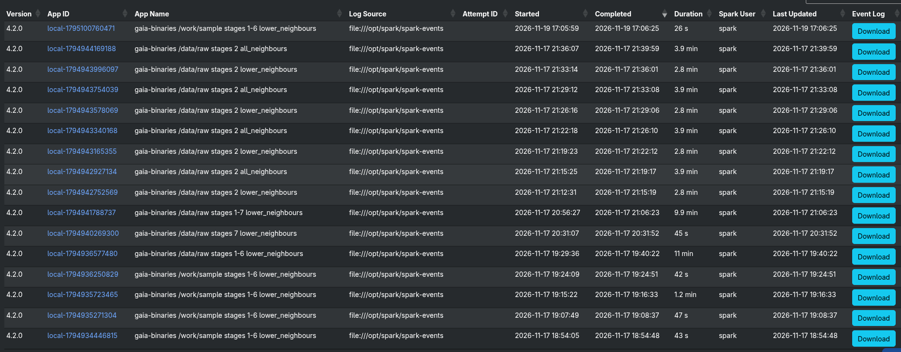

*Рисунок 9 - список застосунків у History Server: 8 запусків експерименту (`stages 2`) по 2,8 хв для A і 3,9 хв для B, нижче повний запуск і запуски на вибірці*

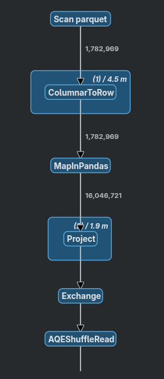 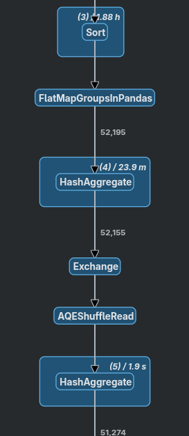 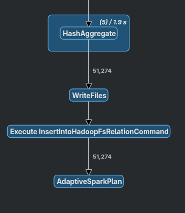

*Рисунок 10 - план варіанту B (`local-1794944169188`): `MapInPandas` дає 16 046 721 рядок (9,00 на зірку), пошук пар - 52 195 пар, а другий `Exchange` з `HashAggregate` (`dropDuplicates`) лишає 51 274*

### Порівняння з прогнозом

```
shuffle write:  1 599,5 / 888,8   = 1,80   (прогноз 1,8)
час етапу 2:    227,4 / 163,5     = 1,39   (прогноз 1,0-1,8)
час задач:      1 600,7 / 1 138,6 = 1,41
```

Shuffle збігся з прогнозом точно. На Рисунку 10 видно і самі рядки: `MapInPandas` у варіанті B дає 16 046 721 рядок, тобто рівно 9,00 на зірку, проти 5,01 у варіанті A.
Другий shuffle варіанту B (`dropDuplicates`) майже нічого не додає: через нього йде лише 52 195 пар. З них дублікатів 52 195 − 51 274 = 921, тобто лише 1,8% пар мають зірки в різних комірках. Решта 98% пар лежать в одній комірці: найчастіше s = 1 000-3 162 а.о. (розділ 10), тобто кут у 16-50 разів менший за максимальні 500″, а комірка має 824″.
Початкова гіпотеза про час (1,8-1,9) не підтвердилась, а уточнена підтвердилась. Оцінимо, яка частина часу задач не залежить від кількості рядків. Нехай час задач = F + v, де F - постійна частина, а v росте пропорційно рядкам у shuffle:

```
A: F + v       = 1 138,6 с
B: F + 1,8 × v = 1 600,7 с
0,8 × v = 462,1 с  =>  v ≈ 577,6 с,  F ≈ 561,0 с
F / 37 878 комірок ≈ 15 мс на комірку
```

Приблизно половина часу задач етапу 2 не залежить від кількості рядків і порівнянь. Модель груба, бо порівнянь у B росте трохи більше ніж у 1,8 раза, тож F насправді дещо більша.

### Висновок

Копіювання лише в комірки з меншим номером зменшує shuffle на 44% (888,8 замість 1 599,5 МБ), прибирає другий shuffle і скорочує етап 2 на 28% (163,5 замість 227,4 с) без зміни результату.
Виграш за часом менший, ніж за байтами, бо половина часу - накладні витрати на групу, однакові в обох варіантах.
Варіант A можливий лише тому, що комірки мають порядок (номер HEALPix), а зона пошуку симетрична: якщо a бачить b, то й b бачить a. Варіант B простіший і потрібен, коли цього немає, наприклад якщо радіус пошуку в кожної зірки свій.

## 9. Валідація за каталогом El-Badry et al. (2021)

El-Badry, Rix & Heintz (2021) шукали широкі пари по всьому небу в Gaia eDR3 (астрометрія та сама, що в DR3) і опублікували каталог з 1,8 млн пар (Zenodo, CC BY 4.0).
Я взяв їхні умови відбору, щоб розбіжності показували помилки в коді, а не різницю в критеріях.
З їхнього каталогу лишаю пари, де обидві зірки в наших 22 файлах, 1 ≤ ϖ ≤ 10 мас і s < 50 000 а.о.: таких 46 959.

| | Значення |
|---|---|
| Їхніх пар у нашій ділянці й межах | 46 959 (з них надійних, R < 0,1: 45 129) |
| Повнота етапу 2 / етапу 3 | **100% / 100%** (46 959 з 46 959) |
| Чистота етапу 3 | 91,8% (46 959 з 51 155) |

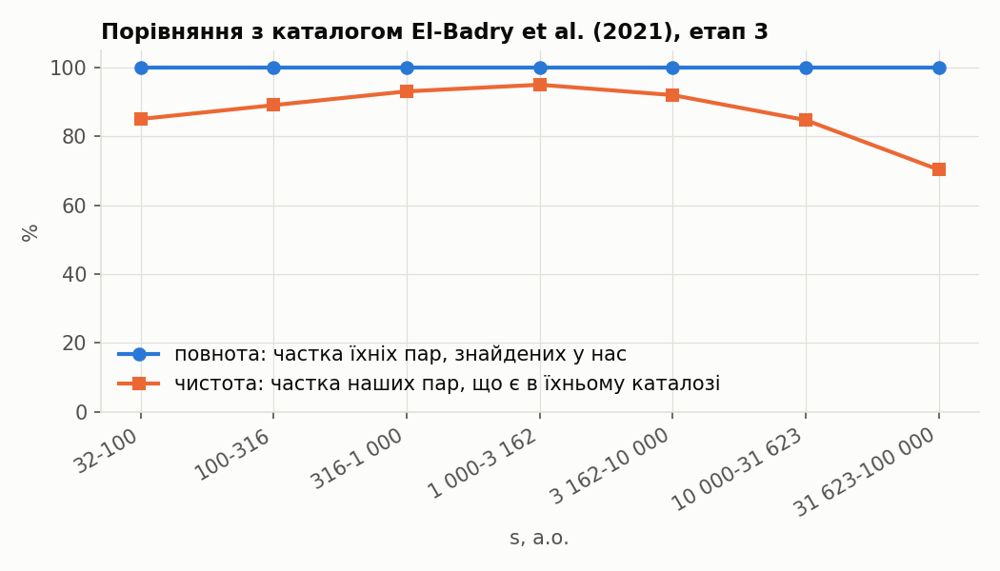

*Рисунок 11 - повнота й чистота за бінами проєкційної відстані*

Повнота 100% означає, що конвеєр знаходить усі їхні пари.
Чистота нижча за 100%, бо ми знаходимо на 4 196 пар більше. На великих s це переважно випадкові збіги: чистота в біні 31 623-100 000 а.о. 70%, а етап 6 дає там 41% випадкових збігів. На малих s, найімовірніше, це пари з трійок і рухомих груп, які El-Badry прибирає строгішим очищенням (сусіди в радіусі 5 пк), а ми - ні. Цю версію я не перевіряв числами.

## 10. Результат: відповідь на питання

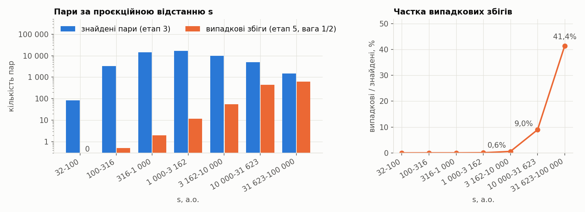

*Рисунок 12 - знайдені пари й випадкові збіги за проєкційною відстанню (ліворуч кількість, праворуч частка випадкових)*

| s, а.о. | Знайдено пар | Випадкових збігів | Частка випадкових | Справжніх ≈ |
|---|---:|---:|---:|---:|
| 32-100 | 82 | 0 | 0% | 82 |
| 100-316 | 3 259 | 0,5 | 0,02% | 3 259 |
| 316-1 000 | 14 481 | 2 | 0,01% | 14 479 |
| 1 000-3 162 | 16 911 | 11,5 | 0,07% | 16 900 |
| 3 162-10 000 | 9 936 | 56 | 0,56% | 9 880 |
| 10 000-31 623 | 4 937 | 442,5 | 9,0% | 4 495 |
| 31 623-100 000 | 1 477 | 612 | 41,4% | 865 |
| **Разом** | **51 083** | **1 124,5** | **2,2%** | **≈49 960** |

(Пари з θ < 0,5″ не враховано: Gaia погано розділяє такі близькі зірки. Тому разом 51 083, а не 51 155.)

Випадкові збіги мають дробову кількість, бо пар «оригінал - копія» вдвічі більше можливих комбінацій, ніж справжніх пар, тож кожна така пара важить 1/2, як у статті: 2 252 / 2 = 1 126, а без пар з θ < 0,5″ лишається 1 124,5.

**Відповідь.**
- У ділянці 1 973 кв. град. навколо зеніту серед 1,78 млн зірок на відстанях 100-1 000 пк є ≈50 000 широких подвійних зірок: 100 477 зірок, тобто 5,6% усіх, входять у пару чи систему.
- Найбільше пар з розділенням 1 000-3 162 а.о. Далі кількість спадає, бо широкі пари легше руйнуються припливами Галактики й зустрічами з іншими зірками.
- **Знайденим парам можна довіряти до ≈10 000 а.о.:** там випадкових збігів менше 1%. На 10 000-31 623 а.о. кожна одинадцята пара - випадковий збіг, а на 31 623-100 000 а.о. випадкові збіги становлять 41%. Без статистичної поправки ці пари використовувати не можна.
- **Більшість систем - пари.** Етап 4 об'єднав їх так:

  | Розмір системи | Кількість |
  |---|---:|
  | пари | 48 992 |
  | трійки | 779 |
  | четвірки | 32 |
  | системи з 5 і 9 зірок | по 2 |

  Трійки становлять 1,6% систем.

## 11. Що пішло не так

- **Етап 5 рахував пари тричі.** Знайшов на вибірці за shuffle read у History Server і виправив через `localCheckpoint` (розділ 5).
- **Анонімні job-и в Spark UI.** Без підписів job-и AQE мали назви на кшталт `$anonfun$withThreadLocalCaptured$1 at CompletableFuture`, і зіставити їх з етапами було неможливо. Додав `metrics.job()`, який підписує кожну дію як `<етап> - <дія>`.
- **Журнал подій не копіювався.** Spark 4 пише журнал папкою `eventlog_v2_<app_id>` з власником - користувачем контейнера, тож звичайний `cp` з хоста не мав доступу. Скопіював через `podman unshare cp`.

## 12. Відтворення й докази

Як запустити: `README.md` (`make run-sample` на вибірці за ≈30-50 с, `make run-full` на повних даних за ≈10 хв).

Докази повного запуску (`evidence/`):
- `spark-events/eventlog_v2_local-1794941788737` - журнал подій для History Server (1,4 МБ, стиснений);
- `plans/` - плани `explain("formatted")` кожного етапу;
- `metrics.json` - кількість записів, відкинуті рядки, розподіл ключів, час етапів;
- `stage6_stats.csv`, `stage7_validation.csv` - результати;
- `shuffle_skew.md` - розподіл задач для кожного shuffle;
- `experiment/` - 8 запусків експерименту, таблиця замірів і плани обох варіантів.

Скриншоти терміналу з усіх запусків: `docs/logs/`.

## Джерела

- Gaia Collaboration, 2022, Gaia DR3, https://doi.org/10.5270/esa-qa4lep3
- El-Badry K., Rix H.-W., Heintz T. M., 2021, MNRAS 506, 2269, https://arxiv.org/abs/2101.05282; каталог: https://zenodo.org/records/4435257
